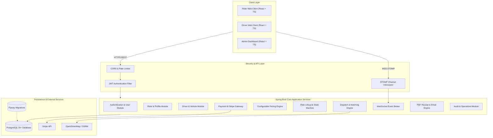

# System Architecture Documentation

## 1. Overview
The Cab Booking Platform is built using a clean, layered monolithic architecture, designed with modular boundaries that allow future microservices extraction (Auth, Dispatch, Pricing, Billing, Realtime).

## 2. Core Modules & Responsibilities

1. **Authentication (`com.cab.booking.auth`)**:
   - Handles Registration, Login, Refresh Token rotation, Logout, Password Reset.
   - Enforces Role-Based Access Control (`RIDER`, `DRIVER`, `ADMIN`).
   - Generates and verifies HMAC-SHA256 JWT tokens.

2. **User & Driver Management (`com.cab.booking.user`, `com.cab.booking.driver`)**:
   - Rider profiles, saved places (Home, Work).
   - Driver onboarding, vehicle registration, and document verification queue.
   - Driver availability toggle (`ONLINE`, `OFFLINE`, `BUSY`) and real-time coordinates.

3. **Pricing Engine (`com.cab.booking.pricing`)**:
   - Calculates deterministic fares: `Base Fare + (Distance * Rate/km) + (Duration * Rate/min) * Vehicle Multiplier * Surge Multiplier - Promo Discount`.
   - Ensures monetary precision using `BigDecimal` and two decimal places.

4. **Dispatch Engine (`com.cab.booking.dispatch`)**:
   - Uses the Haversine distance formula to find verified, online drivers within a configurable radius (e.g. 5-15 km).
   - Concurrency safe: Pessimistic/Optimistic locking guarantees that multiple drivers cannot accept the same ride.

5. **Ride Lifecycle (`com.cab.booking.ride`)**:
   - Enforces state transitions: `REQUESTED -> ACCEPTED -> DRIVER_ARRIVING -> DRIVER_ARRIVED -> IN_PROGRESS -> COMPLETED`.
   - Handles cancellations according to policy (free cancellation before driver acceptance; fee policy after dispatch).
   - Emits immutable `RideEvent` records for complete auditability.

6. **Real-time Messaging (`com.cab.booking.realtime`)**:
   - Spring WebSocket + STOMP over SockJS.
   - Topics: `/topic/rides/{rideId}`, `/queue/driver/{driverId}/requests`, `/topic/admin/rides`.
   - Broadcasts driver GPS updates, ride state changes, and urgent notifications.

7. **Payments (`com.cab.booking.payment`)**:
   - Stripe Java SDK integration with `PaymentIntent`.
   - Webhook signature verification (`Stripe-Signature` header with `Webhook.constructEvent`).
   - Idempotency key tracking to eliminate double charging.

8. **Receipts & Communications (`com.cab.booking.receipt`, `com.cab.booking.notification`)**:
   - Generates official PDF invoices via OpenPDF / iText.
   - Email notifications via Spring Mail (booking confirmations, trip receipts, verification).
