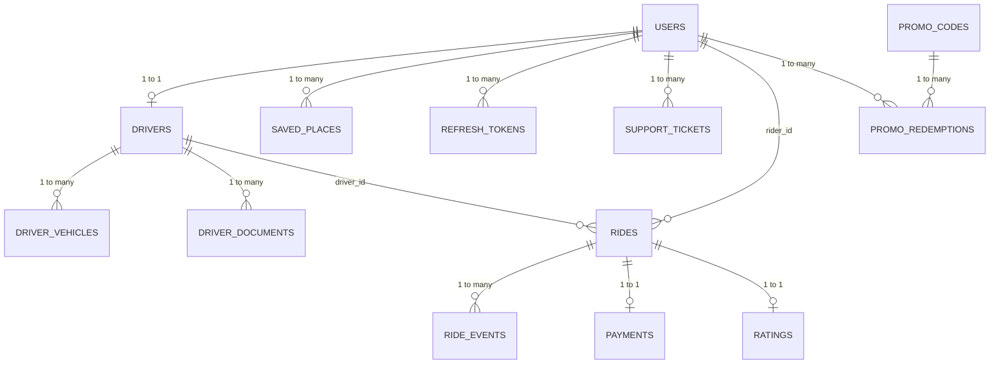

# Database Design & Schema Specification

## 1. Entity-Relationship Overview

## 2. Table Specifications

### 2.1 `users`
- `id` (BIGSERIAL PRIMARY KEY)
- `full_name` (VARCHAR(100) NOT NULL)
- `email` (VARCHAR(150) NOT NULL UNIQUE)
- `phone_number` (VARCHAR(20) NOT NULL UNIQUE)
- `password_hash` (VARCHAR(255) NOT NULL)
- `role` (VARCHAR(20) NOT NULL) -- `RIDER`, `DRIVER`, `ADMIN`
- `account_status` (VARCHAR(20) NOT NULL DEFAULT 'ACTIVE') -- `ACTIVE`, `SUSPENDED`, `INACTIVE`
- `email_verified` (BOOLEAN NOT NULL DEFAULT FALSE)
- `created_at` (TIMESTAMPTZ NOT NULL DEFAULT NOW())
- `updated_at` (TIMESTAMPTZ NOT NULL DEFAULT NOW())

### 2.2 `drivers`
- `id` (BIGSERIAL PRIMARY KEY)
- `user_id` (BIGINT NOT NULL UNIQUE REFERENCES users(id) ON DELETE CASCADE)
- `license_number` (VARCHAR(50) NOT NULL UNIQUE)
- `verification_status` (VARCHAR(20) NOT NULL DEFAULT 'PENDING') -- `PENDING`, `APPROVED`, `REJECTED`
- `availability_status` (VARCHAR(20) NOT NULL DEFAULT 'OFFLINE') -- `ONLINE`, `OFFLINE`, `BUSY`
- `current_latitude` (DOUBLE PRECISION)
- `current_longitude` (DOUBLE PRECISION)
- `last_location_update` (TIMESTAMPTZ)
- `average_rating` (NUMERIC(3,2) NOT NULL DEFAULT 5.00)
- `total_completed_rides` (INT NOT NULL DEFAULT 0)
- `created_at` (TIMESTAMPTZ NOT NULL DEFAULT NOW())
- `updated_at` (TIMESTAMPTZ NOT NULL DEFAULT NOW())

### 2.3 `driver_vehicles`
- `id` (BIGSERIAL PRIMARY KEY)
- `driver_id` (BIGINT NOT NULL REFERENCES drivers(id) ON DELETE CASCADE)
- `vehicle_type` (VARCHAR(20) NOT NULL) -- `SEDAN`, `HATCHBACK`, `SUV`, `PREMIUM`
- `make` (VARCHAR(50) NOT NULL)
- `model` (VARCHAR(50) NOT NULL)
- `year` (INT NOT NULL)
- `registration_number` (VARCHAR(30) NOT NULL UNIQUE)
- `color` (VARCHAR(30) NOT NULL)
- `seating_capacity` (INT NOT NULL DEFAULT 4)
- `verification_status` (VARCHAR(20) NOT NULL DEFAULT 'PENDING')
- `created_at` (TIMESTAMPTZ NOT NULL DEFAULT NOW())

### 2.4 `rides`
- `id` (BIGSERIAL PRIMARY KEY)
- `rider_id` (BIGINT NOT NULL REFERENCES users(id))
- `driver_id` (BIGINT REFERENCES drivers(id))
- `pickup_address` (TEXT NOT NULL)
- `pickup_latitude` (DOUBLE PRECISION NOT NULL)
- `pickup_longitude` (DOUBLE PRECISION NOT NULL)
- `dropoff_address` (TEXT NOT NULL)
- `dropoff_latitude` (DOUBLE PRECISION NOT NULL)
- `dropoff_longitude` (DOUBLE PRECISION NOT NULL)
- `vehicle_category` (VARCHAR(20) NOT NULL DEFAULT 'SEDAN')
- `distance_km` (NUMERIC(8,2) NOT NULL)
- `estimated_duration_minutes` (INT NOT NULL)
- `estimated_fare` (NUMERIC(10,2) NOT NULL)
- `final_fare` (NUMERIC(10,2))
- `currency` (VARCHAR(10) NOT NULL DEFAULT 'USD')
- `ride_status` (VARCHAR(30) NOT NULL DEFAULT 'REQUESTED')
- `cancellation_reason` (TEXT)
- `cancelled_by` (VARCHAR(20))
- `requested_at` (TIMESTAMPTZ NOT NULL DEFAULT NOW())
- `accepted_at` (TIMESTAMPTZ)
- `arrived_at` (TIMESTAMPTZ)
- `started_at` (TIMESTAMPTZ)
- `completed_at` (TIMESTAMPTZ)
- `cancelled_at` (TIMESTAMPTZ)
- `version` (BIGINT NOT NULL DEFAULT 0) -- Optimistic lock counter
- `created_at` (TIMESTAMPTZ NOT NULL DEFAULT NOW())
- `updated_at` (TIMESTAMPTZ NOT NULL DEFAULT NOW())

### 2.5 `payments`
- `id` (BIGSERIAL PRIMARY KEY)
- `ride_id` (BIGINT NOT NULL UNIQUE REFERENCES rides(id))
- `amount` (NUMERIC(10,2) NOT NULL)
- `currency` (VARCHAR(10) NOT NULL DEFAULT 'USD')
- `payment_provider` (VARCHAR(30) NOT NULL DEFAULT 'STRIPE')
- `provider_payment_intent_id` (VARCHAR(100))
- `payment_status` (VARCHAR(30) NOT NULL DEFAULT 'PENDING') -- `PENDING`, `COMPLETED`, `FAILED`, `REFUNDED`
- `idempotency_key` (VARCHAR(100) NOT NULL UNIQUE)
- `paid_at` (TIMESTAMPTZ)
- `refunded_amount` (NUMERIC(10,2) DEFAULT 0.00)
- `created_at` (TIMESTAMPTZ NOT NULL DEFAULT NOW())
- `updated_at` (TIMESTAMPTZ NOT NULL DEFAULT NOW())

### 2.6 `ratings`
- `id` (BIGSERIAL PRIMARY KEY)
- `ride_id` (BIGINT NOT NULL UNIQUE REFERENCES rides(id))
- `rider_id` (BIGINT NOT NULL REFERENCES users(id))
- `driver_id` (BIGINT NOT NULL REFERENCES drivers(id))
- `stars` (INT NOT NULL CHECK (stars >= 1 AND stars <= 5))
- `comment` (TEXT)
- `created_at` (TIMESTAMPTZ NOT NULL DEFAULT NOW())
